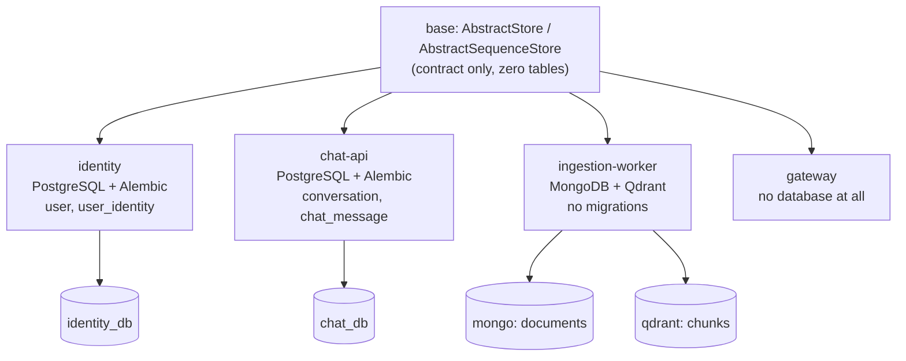

# 03 — Data Ownership

> **Requirement:** services must not share tables. Each service controls its own database —
> SQL, NoSQL, or none at all — with whatever structure it needs.

## The rule

> **A service owns its data store exclusively.** No other service may read or write it
> directly — not another table, not another schema, not a read-only replica, not "just this
> one join".

Shared tables are the coupling that makes microservices worse than a monolith: you get
distributed deployment *and* a shared schema that nobody can change independently.

### Three corollaries

1. **No cross-service foreign keys.** A conversation references its owner as
   `user_id: UUID` with no `ForeignKey(...)` and no constraint. The database cannot enforce
   what it cannot see, and that is the point — the reference is to an *identity*, not to
   a row.
2. **No shared `metadata`.** See *Metadata isolation* below. This is the subtle one.
3. **No shared migration history.** Each service's `alembic/versions/` is its own linear
   history against its own database.

---

## What already supports this

`AbstractStore` in `base/services/store/__init__.py` is explicitly storage-agnostic:

```python
class AbstractStore(ABC, Generic[T]):
    """Database-agnostic abstract store. Works with SQL and NoSQL services.

    Subclasses are responsible for:
    - Setting up their own database service (SQL or NoSQL) in __init__
    - Implementing all abstract CRUD methods
    - Overriding _duplicate_error_types() to map their DB's duplicate-key
      exception (e.g. SQLAlchemy IntegrityError, PyMongo DuplicateKeyError)
    """
```

`AbstractSequenceStore` makes the same promise for ordered, parent-scoped data, and
explicitly anticipates `SqlChatHistoryStore` / `MongoChatHistoryStore` as peers.

**The abstraction is right. What is wrong is that `base` also ships concrete,
table-bound implementations** — `store/user.py`, `store/conversation.py`,
`store/user_identity.py`, `store/chat_history/sql.py`. Those move to the owning service
([doc 02](02-library-boundary.md)); the abstract contracts stay.

---

## Metadata isolation (the subtle part)

SQLAlchemy collects tables onto the `MetaData` of the `DeclarativeBase` they inherit from.
**Inheriting a shared `Base` means sharing `metadata`**, which means every service's
`alembic autogenerate` sees every other service's tables and tries to create them.

This does **not** achieve isolation:

```python
# WRONG — shares base.models.orm.Base.metadata with every other service
from base.models.orm import Base

class Conversation(Base):
    __tablename__ = "conversation"
```

Each service must declare **its own `DeclarativeBase`**, reusing `base`'s behaviour via
**mixins** rather than inheritance of the declarative root:

```python
# services/chat-api/chat_api/models/orm/__init__.py
from sqlalchemy.orm import DeclarativeBase, MappedAsDataclass

from base.models.orm import SerializableMixin, TimestampMixin


class ChatBase(MappedAsDataclass, DeclarativeBase, SerializableMixin):
    """Declarative root for chat-api. Owns its own MetaData."""


__all__ = ["ChatBase", "SerializableMixin", "TimestampMixin"]
```

```python
# services/chat-api/chat_api/models/orm/conversation.py
from uuid import UUID, uuid4

from sqlalchemy.orm import MappedColumn, mapped_column
from sqlalchemy_utils.types.uuid import UUIDType

from chat_api.models.orm import ChatBase, TimestampMixin


class Conversation(TimestampMixin, ChatBase):
    __tablename__ = "conversation"

    id: MappedColumn[UUID] = mapped_column(
        UUIDType(binary=False), primary_key=True, default_factory=uuid4
    )
    # Owner lives in the identity service. Opaque reference — no ForeignKey.
    user_id: MappedColumn[UUID] = mapped_column(UUIDType(binary=False), index=True)
    title: MappedColumn[str] = mapped_column(default="")
```

> **Keep the existing mixin order when converting a table.** These models use
> `MappedAsDataclass`, where the base-class order determines both the generated
> `__init__` signature and column declaration order. Converting
> `class X(TimestampMixin, Base)` to `class X(ChatBase, TimestampMixin)` changes the MRO
> for no benefit; swapping only the declarative root keeps the move a true rename.

### What `base` keeps

`base/models/orm/` is reduced to reusable behaviour with **no tables and no declarative
root**:

- `TimestampMixin` — `created_at` / `updated_at` / `deleted_at`, `soft_delete()`,
  `restore()` (lift as-is from today's file)
- `SerializableMixin` — `to_dict()`, `update_from_dict()`, `clone()`
- **Removed:** `_import_all_tables()` and its import-time invocation
- **Removed:** the shared `Base` declarative root

`base/tools/serializers.py` imports only `Base` today; it should be retyped against
`DeclarativeBase` so it works with any service's root.

---

## A service may choose any storage

The `AbstractStore` contract is the only thing `base` requires. The backing store is a
private implementation detail.



### SQL service

- Depends on `base[sql,postgres]`
- Has `alembic.ini` + `alembic/versions/`
- Defines its own `DeclarativeBase`
- Stores extend `AbstractStore` over `SQLService`

### NoSQL-only service

- Depends on `base[mongo]` — **no `sql` extra, no SQLAlchemy, no Alembic at all**
- Defines Pydantic documents instead of ORM models
- Stores extend the same `AbstractStore`, overriding `_duplicate_error_types()`:

```python
from pymongo.errors import DuplicateKeyError

from base.services.store import AbstractStore


class MongoDocumentStore(AbstractStore[Document]):
    def _duplicate_error_types(self) -> tuple[type[BaseException], ...]:
        return (DuplicateKeyError,)
```

The service layer above is identical in both cases — that is the whole return on the
abstraction.

### Stateless service

Depends on neither. A gateway or BFF has no store and no migrations.

---

## Per-service migrations

Each SQL service gets its own `alembic.ini` and `alembic/` directory, with `env.py`
importing only its own models.

```python
# services/chat-api/alembic/env.py  (sketch — structure mirrors today's root env.py)
from chat_api.models.orm import ChatBase
from chat_api.settings import settings

import chat_api.models.orm.conversation            # noqa: F401
import chat_api.models.orm.chat_history_message    # noqa: F401

target_metadata = ChatBase.metadata


def _get_async_url() -> str:
    return settings.sql_async_url
```

Keep today's `_compare_type` hook that suppresses false-positive `UUIDType` diffs on
SQLite — it is still needed per service.

| Property | Value |
| --- | --- |
| Run from | `services/<name>/` |
| Command | `uv run --package <name> alembic upgrade head` |
| Container | Carries only its own `alembic/` directory |
| Trigger | Existing `RUN_MIGRATIONS` env flag in `run.sh`, kept per service |

**Never** let service A's migration touch service B's tables. If that seems necessary, the
boundary is in the wrong place.

> **Ordering note:** migration jobs run per service, so deployments must tolerate services
> being at different schema versions simultaneously. Expand/contract: add nullable columns
> first, backfill, then make them required in a later release.

---

## The identity case

Today `user` / `user_identity` live in `base`, and `base/services/auth/dependencies.py`
imports `base.models.orm.user.UserDTO` directly — so *any* service inheriting `base` auth
also inherits the user table.

**Target:** the `identity` service owns those tables. Every other service verifies the JWT
statelessly with a public key and trusts the claims. No other service queries the user
table. Full design in [doc 05](05-service-contracts.md).

This is the change that unlocks everything else — it is the only place where `base`'s
domain coupling is structural rather than incidental.

---

## When two services need the same data

Ranked by preference:

| # | Pattern | Use when | Cost |
| --- | --- | --- | --- |
| 1 | **Claims in the token** | Data is identity-ish (`user_id`, roles, tenant) | Free — no call |
| 2 | **Synchronous API call** | Fresh data needed, caller can tolerate the latency and the dependency | Coupling + latency |
| 3 | **Event + local projection** | Read-heavy, staleness acceptable | Eventual consistency |
| 4 | **Cached projection** | Hot path over pattern 2 | Invalidation |
| — | **Shared table** | ~~Never~~ | Defeats the architecture |

For pattern 3, the owning service publishes `UserRegistered` / `UserDeactivated` to the
broker, and consumers keep a **local, narrow, read-only projection** — e.g. chat-api holds
`user_id` + `display_name` only, in *its own* database. It is a cache, not a copy: it may
be rebuilt from events at any time.

Use the **transactional outbox** when the event must not be lost: write the domain row and
an `outbox` row in one local transaction, then relay asynchronously.

---

## Local development

One container per engine, one **logical database per service** — cheap locally, identical
in topology to production.

```yaml
# deploy/docker-compose.infra.yml (excerpt)
postgres:
  image: postgres:17-alpine
  environment:
    POSTGRES_PASSWORD: local
  volumes:
    - ./init-dbs.sql:/docker-entrypoint-initdb.d/init-dbs.sql
```

```sql
-- deploy/init-dbs.sql
CREATE DATABASE identity_db;
CREATE DATABASE chat_db;
```

Separate **databases**, not schemas. Schemas in one database tempt people into
cross-schema joins, and the tooling will happily let them.

> **Namespacing applies beyond SQL.** `CacheChannels.for_app(app_name)` already prefixes
> Redis pub/sub channels per app — extend the same discipline to cache keys, blob
> containers, queue names and vector collections so shared infrastructure never collides.

---

## Checklist for a new service

- [ ] Declares its own `DeclarativeBase` (or uses no SQL at all)
- [ ] Owns its connection string via its own settings and `.env`
- [ ] Has its own `alembic/versions/`, or none
- [ ] Contains **no** `ForeignKey` to another service's table
- [ ] Contains **no** import of another service's models
- [ ] Namespaces every shared-infrastructure key by service name
