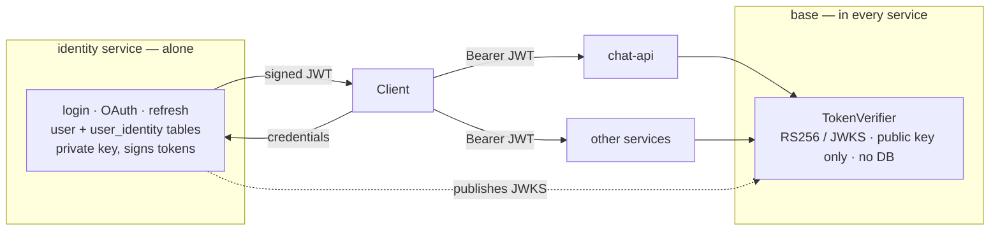

# 05 — Service Contracts

How services authenticate, call each other, and stay debuggable once there is more than one
of them.

---

## Authentication: split verification from identity

### Today

`base/services/auth/dependencies.py`:

```python
from base.models.orm.user import UserDTO
from base.services.auth import AuthService


async def validate_user(request, credentials=http_bearer_dependency) -> UserDTO:
    return await AuthService().validate_user(credentials)
```

Every protected route resolves to a **database-backed `UserDTO`**. In a multi-service
world that would force every service to carry the user table — exactly what
[doc 03](03-data-ownership.md) forbids.

### Target

Split `base/services/auth` along the line between *verifying a token* (every service) and
*owning users* (one service).



| Concern | Lives in | Needs |
| --- | --- | --- |
| Verify signature, expiry, issuer, audience | `base` — every service | Public key / JWKS. **No database** |
| Issue, refresh, revoke tokens | `identity` only | Private key |
| User records, password hashes, OAuth links | `identity` only | Its own database |
| Login, OAuth callbacks, registration | `identity` only | — |

### The shared dependency returns a principal, not a row

```python
# packages/base/base/services/auth/principal.py
from uuid import UUID

from pydantic import BaseModel


class Principal(BaseModel):
    """Who the caller is, from verified token claims. Never a database row."""

    user_id: UUID
    email: str | None = None
    roles: frozenset[str] = frozenset()
    tenant_id: UUID | None = None
    scopes: frozenset[str] = frozenset()
    raw_claims: dict = {}

    def require_role(self, role: str) -> None:
        if role not in self.roles:
            raise_error(AuthErrors.FORBIDDEN)
```

```python
# packages/base/base/services/auth/dependencies.py
async def current_principal(
    credentials: HTTPAuthorizationCredentials = http_bearer_dependency,
) -> Principal:
    return TokenVerifier().verify(credentials.credentials)


principal_dependency = Depends(current_principal)
```

Every service uses this. `chat-api` learns the caller's `user_id` with **zero** database
access and **zero** knowledge of the user schema. The existing enterprise IdP settings
(`idp_issuer`, `idp_jwks_url`, `idp_algorithms`) slot straight into `TokenVerifier` —
verifying a first-party token and an Entra token becomes the same code path.

If a service genuinely needs profile data beyond claims, it calls the identity API — and
should usually cache or project it instead ([doc 03](03-data-ownership.md), "When two
services need the same data").

### Key distribution

| Approach | When |
| --- | --- |
| Public key mounted per service (`AUTH_PUBLIC_KEY_PATH`) | Simple, static, few services. Matches today's settings |
| JWKS endpoint on identity, cached with TTL | Preferred at scale — enables key rotation without redeploying consumers |

Today's `keys/` directory is gitignored, so nothing changes there. The private key goes to
**identity only**; ship the public key everywhere else.

### Service-to-service calls

Two distinct cases, and they should not be conflated:

1. **Acting for a user** — forward the caller's token. Preserves the audit trail, and the
   downstream service applies the user's own permissions.
2. **Acting as itself** (background jobs, cron) — client-credentials token with a
   `service:<name>` subject and narrow scopes. A worker should not borrow a user's
   authority to do system work.

---

## Synchronous communication

`base/services/http` exists but is empty-ish; it becomes the base for typed clients.

```python
# packages/base/base/services/http/service_client.py
class ServiceClient:
    """Base for typed clients to other services.

    Provides: base URL from settings, timeouts, bounded retries with backoff,
    circuit breaking, correlation-ID propagation, and auth forwarding.
    """

    service: ClassVar[str]

    async def get(self, path: str, *, model: type[T]) -> T: ...
    async def post(self, path: str, *, body: BaseModel, model: type[T]) -> T: ...
```

```python
# services/chat-api/chat_api/clients/identity.py
from contracts.v1.identity import UserProfile

from base.services.http.service_client import ServiceClient


class IdentityClient(ServiceClient):
    service = "identity"

    async def get_profile(self, user_id: UUID) -> UserProfile:
        return await self.get(f"/users/{user_id}", model=UserProfile)
```

Non-negotiables for every outbound call:

| Property | Rule |
| --- | --- |
| Timeout | Always set. A missing timeout is how one slow service stalls the fleet |
| Retries | Idempotent verbs only (`GET`/`PUT`/`DELETE`), capped, exponential backoff + jitter |
| Circuit breaker | Fail fast when a dependency is down instead of queueing doomed work |
| Correlation ID | Forwarded — see below |
| Base URL | From settings (`IDENTITY_BASE_URL`), never hardcoded |

Timeout budgets must shrink as calls nest: if the inbound request budget is 30s, an
outbound call gets meaningfully less, so failure surfaces before the client gives up.

---

## Asynchronous communication

`base/services/background_tasks/` contains only `in_memory.py`. In-process tasks die with
the process and cannot cross a service boundary — so this is the main **gap** for
microservices.

Introduce an `AbstractBroker` following the same shape as `AbstractStore`:

```python
class AbstractBroker(ABC):
    @abstractmethod
    async def publish(self, topic: str, event: Event) -> None: ...

    @abstractmethod
    async def subscribe(self, topic: str, group: str, handler: Handler) -> None: ...
```

| Implementation | Extra | Use |
| --- | --- | --- |
| `InMemoryBroker` | — | Local dev, tests. Exists today |
| `RedisStreamsBroker` | `base[redis]` | Default. Redis is already a dependency, consumer groups give at-least-once |
| `ServiceBusBroker` | `base[azure]` | Azure deployments needing durability/DLQ |

Handler rules:

- **Idempotent** — at-least-once delivery means handlers *will* see duplicates. Dedupe on
  `event_id`.
- **Dead-letter after bounded retries** — never retry forever.
- **Topics namespaced by service**, consistent with `CacheChannels.for_app(app_name)`.

A worker service is then just `create_app()` without routers: a broker subscription plus a
lifespan, no HTTP server, and no `server` extra.

---

## The `contracts` package

Shared request/response models and event schemas, depending on **pydantic only** — never
on `base`, never on a service. That keeps it a leaf node that anyone can import without
pulling in infrastructure.

```
packages/contracts/contracts/
├── v1/
│   ├── identity.py      # UserProfile, TokenResponse
│   └── chat.py          # ConversationSummary
└── events/
    ├── identity.py      # UserRegistered, UserDeactivated
    └── ingestion.py     # DocumentIngested
```

```python
# packages/contracts/contracts/events/identity.py
from datetime import datetime
from uuid import UUID

from pydantic import BaseModel


class UserRegistered(BaseModel):
    event_id: UUID
    occurred_at: datetime
    user_id: UUID
    email: str
```

Rules:

- **Version the namespace** (`v1/`), not individual classes.
- **Additive changes only** within a version — new optional fields are fine; renaming or
  removing is not.
- **Breaking change → `v2/`**, with both served until consumers migrate.
- Producer and consumer import the *same* class, so drift is a type error rather than a
  production incident.

---

## Correlation and tracing

The groundwork is already here. `base/main.py` has:

```python
@app.middleware("http")
async def register_request(request, call_next):
    scope_id.set(uuid4())
    ...
```

and `Stored` scopes instances by that `scope_id`. The gap is that the ID is **always
freshly generated**, so a request crossing three services produces three unrelated IDs and
becomes untraceable.

### Change

```python
incoming = request.headers.get("x-correlation-id") or extract_traceparent(request)
correlation_id.set(UUID(incoming) if incoming else uuid4())
```

Then propagate it everywhere:

| Surface | Action |
| --- | --- |
| Inbound HTTP | Adopt `X-Correlation-ID` / W3C `traceparent`, else generate |
| Outbound HTTP | `ServiceClient` injects the header automatically |
| Broker messages | Carry it in event metadata; the handler re-establishes the context |
| Logs | Every line includes `correlation_id` **and** `service_name` |
| Responses | Echo `X-Correlation-ID` so clients can quote it in bug reports |

This single change is the difference between debugging a distributed system and guessing at
one. The existing `debug_trace` view models extend naturally to span service boundaries.

### OpenTelemetry

Add an optional `base[otel]` extra that auto-instruments FastAPI, httpx and SQLAlchemy and
exports OTLP, with `service.name` bound to `CoreSettings.service_name`. Off by default,
one setting to enable — no per-service wiring.

---

## Service discovery

Deliberately simple: **base URLs in settings**, injected per environment.

```ini
IDENTITY_BASE_URL=http://identity:8000
```

Compose supplies service DNS locally; the platform supplies it in deployment. No registry,
no mesh, no new moving part. If a mesh is later adopted, only the injected URLs change.
